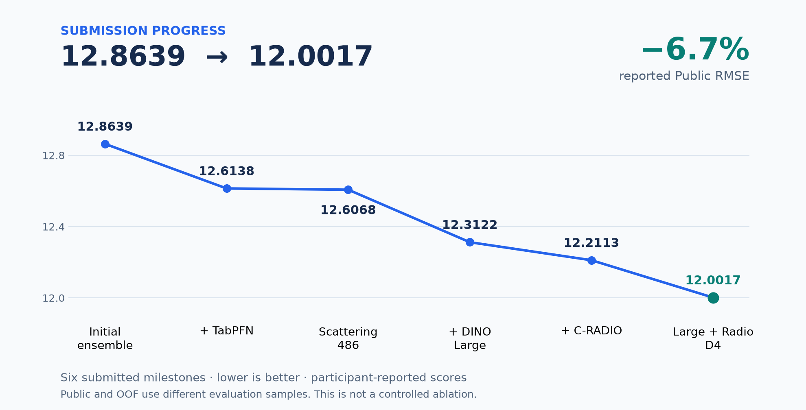
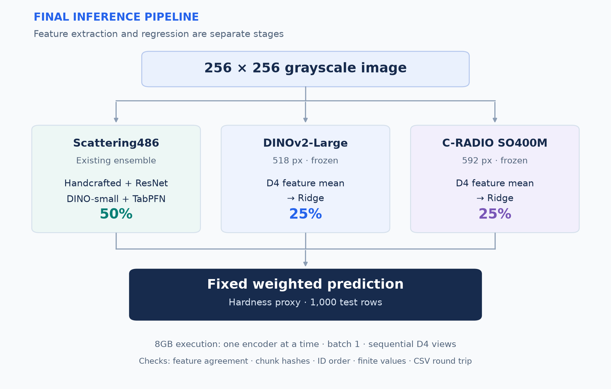
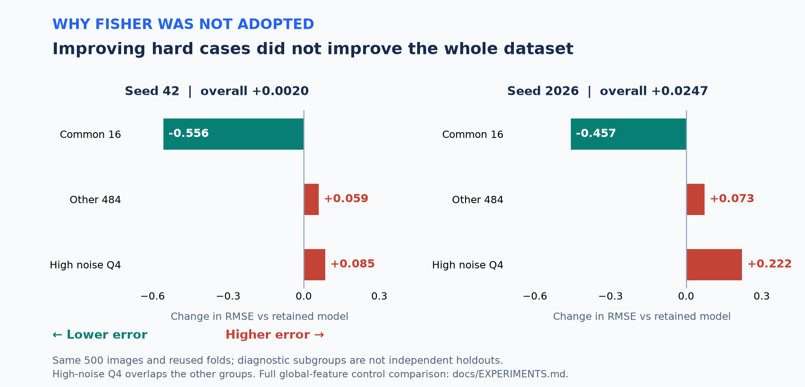

# Microstructure → Property Prediction

[](https://github.com/juuu-sung/microstructure-property-prediction/actions/workflows/evidence.yml)

**500장의 이미지와 8GB GPU로 진행한 미세구조 회귀 · 검증 · 추론 파이프라인 프로젝트**

합성 미세구조 이미지에서 경도 대용값을 예측합니다. 사전학습 비전 모델과 질감 특징을 결합해 최초 제출 대비 **Public RMSE를 12.8639 → 12.0017, 약 6.7% 낮췄습니다.** 작은 데이터에서의 모델 선택, 메모리 제약을 고려한 추론, 실패 사례를 포함한 채택 판단을 코드와 집계 근거로 정리했습니다.

[프로젝트 사례](docs/CASE_STUDY.md) · [대표 코드 3곳](docs/CODE_TOUR.md) · [실험 결과](docs/EXPERIMENTS.md) · [재현 범위](docs/REPRODUCIBILITY.md)



Public은 참가자가 플랫폼에서 확인해 기록한 점수입니다. 아래 OOF와는 평가 표본이 다릅니다. [점수 기록·제출파일 해시](evidence/public_scores.json)

| 프로젝트 개요 | 내용 |
|---|---|
| 데이터 / 환경 | 학습 **500장** · 테스트 **1,000장** · 256×256 회색조 / RTX 5060 **8GB** |
| 최종 구성의 OOF RMSE ↓ | **13.0873 / 13.1126** — seed 42 / 2026, 각 5-fold OOF |
| 기술 | Python · PyTorch · scikit-learn · TabPFN · NumPy · GitHub Actions |
| 상태 | 개인 대회 프로젝트 · **실험 종료, 2026-11-07** |

## 담당 역할과 협업

**직접 담당한 범위는 로컬 실행 환경 운영, 학습·추론 실행, 결과 확인과 후속 실험 요청, 대회 제출, 일부 ROI 검수입니다.** Codex를 실험 설계·코드 작성·분석·문서화에 활용했습니다. 아래 구현과 문서는 이 협업의 산출물입니다.

## 핵심 엔지니어링: 제약을 어떻게 다뤘는가

| 제약 / 질문 | 구현과 선택 | 확인 가능한 결과 |
|---|---|---|
| **500장으로 모델을 어떻게 선택할까?** | 이미지 단위 **5 outer × 3 inner** 검증. 표준화·차원 축소·alpha 선택을 각 학습 분할 안에서 수행 | 외부 fold 정답을 선택 함수에 전달하지 않는 구조. [검증 설계](docs/VALIDATION.md) |
| **대형 인코더를 8GB에서 어떻게 실행할까?** | 인코더 고정, **batch 1·8방향 순차 추론**, 특징 캐시와 청크별 재개. 학습·추론 특징 일치 검사 | 최종 1,000장 예측 생성. ID 순서·유한값·CSV 재읽기 검증. [추론 코드 안내](docs/CODE_TOUR.md#2-8gb-환경에서-중단-후-재개하는-추론) |
| **일부 실패만 좋아진 모델을 채택해도 될까?** | 전체 500장을 공통 실패 **16장 + 나머지 484장**으로 나누고, 잡음·타깃 구간도 비교 | Fisher 후보는 일부 실패를 줄였지만 전체 오차가 늘어 **미채택**. [대조 실험](docs/EXPERIMENTS.md) |

## 최종 추론 구성



**D4**는 0·90·180·270도 회전과 반사로 만든 8개 영상의 특징을 **영상 단위로 평균**하는 처리입니다. 정답이 있는 학습 표본 수는 500장 그대로입니다. Large·C-RADIO의 가중치는 고정하고, Ridge의 alpha는 학습 내부에서 100·1000·10000 중 선택합니다.

<details>
<summary>세부 가중치와 최종 학습 설정</summary>

Scattering486은 기존 앙상블의 이름입니다. 이를 펼친 최종 유효 가중치는 다음과 같습니다.

| 구성 요소 | 최종 가중치 |
|---|---:|
| 수작업 특징 185개 + Ridge | 6.25% |
| ResNet18 특징 + Ridge | 6.25% |
| DINOv2-small D4 + Ridge | 12.5% |
| Scattering 포함 486개 특징 + TabPFN-v2 | 25% |
| DINOv2-Large518 D4 + Ridge | 25% |
| C-RADIO SO400M592 D4 + Ridge | 25% |

전체 500장으로 최종 학습할 때 Large·C-RADIO의 alpha는 모두 1000이 선택됐습니다. 모델별 내부 선택 목적과 기존 구성의 고정 범위는 [검증 문서](docs/VALIDATION.md), 제출 검사 결과는 [최종 구성 기록](evidence/final_model.json)에 있습니다.

</details>

## 성능 개선만큼 중요했던 채택 판단

**채택 — 대형 인코더의 D4 평균:** 직전 구성 대비 두 seed의 평균 OOF RMSE가 **0.1137 감소**했고, 공통16·나머지484·잡음 상위 구간도 양쪽 seed에서 개선됐습니다. 그 구성을 전체 500장으로 학습해 최고 제출로 보존했습니다.

**미채택 — C-RADIO Fisher Vector:** 공통16의 RMSE는 낮아졌지만 나머지484의 제곱오차 증가가 더 컸습니다. 전체 RMSE는 seed42에서 **0.0020**, seed2026에서 **0.0247 악화**했습니다. 전역 특징 대조군에서도 공통16 개선이 나타나, 이를 Fisher만의 기여로 해석하지 않았습니다.



공통16은 기존 오류 분석에서 정한 **사후 진단 집단**입니다. 독립 평가셋이 아니며 이 집단만으로 모델을 선택하지 않았습니다. [전체 대조표와 미채택 모델](docs/EXPERIMENTS.md) · [집계 근거](evidence/oof_metrics.json)

## 코드와 결과를 확인하는 방법

처음에는 [코드 안내](docs/CODE_TOUR.md)의 세 경로만 보면 됩니다: **분할 내 모델 선택 → 재개 가능한 추론 → 대조군별 교체**. 나머지 `scripts/`와 `tests/`는 연구 종료 시점의 소스 기록입니다.

데이터·GPU 없이 공개 집계와 도구를 확인하려면 Python 3.12 이상에서 실행합니다.

```bash
python tools/verify_evidence.py
python -m unittest discover -s portfolio_tests -v
```

**검사 범위:** 240개 연구 소스의 해시, 448개 집계 지표의 일관성, 최종 가중치, 문서 링크 및 공개 도구 테스트 5개. GitHub Actions에서 Ubuntu·Windows로 실행합니다. 원본 OOF 재계산이나 Public 점수 인증은 포함하지 않습니다.

## 한계와 다음 개선

같은 500장을 반복 활용했으므로 모델 탐색에 따른 선택 편향이 남습니다. **목표한 RMSE 10 미만은 달성하지 못했고**, 실제 재료나 운영 서비스에서의 성능도 검증하지 않았습니다. 원본 데이터·가중치·실험 캐시는 미포함이며, 전체 학습의 재실행에는 외부 자산과 역사적 캐시가 필요합니다.

다음 프로젝트에서는 독립 평가 데이터 확보, 실험 예산·중단 기준의 조기 설정, 캐시 이력을 몰라도 실행 가능한 모듈 분리를 우선하겠습니다. [회고](docs/RETROSPECTIVE.md) · [실행 범위](docs/REPRODUCIBILITY.md) · [모델 출처와 권리](docs/ASSETS.md) · [대회 안내](https://daker.ai/public/hackathons/synthetic-microstructure-property-prediction-ai)
