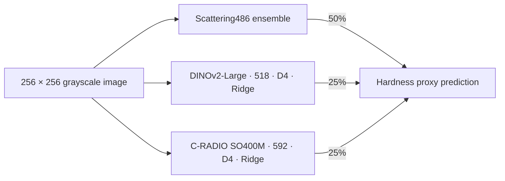

# Microstructure → Property Prediction

**500장의 합성 미세구조 이미지로 경도 대용값을 예측한 머신러닝 실험 프로젝트**

적은 정답 데이터와 RTX 5060 8GB 환경에서 사전학습 표현·질감 특징·표 데이터 모델을 비교하고, 누출을 방지한 중첩 교차검증과 실패 사례 분석으로 최종 앙상블을 선택했습니다.

| 결과 | 내용 |
|---|---|
| 최고 제출 Public RMSE | **12.0017** — 최초 제출 12.8639 대비 **6.7% 감소** |
| 최고 제출 구성의 OOF RMSE | **13.0873 / 13.1126** — seed 42 / 2026 |
| 데이터 | 학습 500장 · 테스트 1,000장 · 256×256 회색조 |
| 연산 환경 | 개인 PC · NVIDIA RTX 5060 8GB · Python / PyTorch / scikit-learn |
| 상태 | **실험 종료 · 2026-11-07** |

Public 점수는 참가자가 플랫폼에서 확인해 기록한 값입니다. 독립적으로 인증한 리더보드 기록이나 수상 실적을 의미하지 않습니다. OOF와 Public은 평가 표본이 달라 직접 비교하지 않습니다.

## 1분 요약

- **문제:** 이미지 500장만으로 다양한 구조·잡음 조건의 경도 대용값을 예측해야 했습니다.
- **접근:** 수작업 특징에서 시작해 DINOv2, C-RADIO, TabPFN과 scattering을 비교하고, 검증에서 보완성이 확인된 표현을 고정 비율로 결합했습니다.
- **검증:** 5 outer × 3 inner 검증, 학습 분할 안에서의 표준화·PCA·모델 선택, 입력·소스 해시와 중단 재개 검사를 구현했습니다.
- **분석:** 반복되는 실패 16장과 나머지 484장을 분리해, 일부 사례 개선이 전체 성능을 희생하는지 확인했습니다.
- **판단:** 더 큰 모델이나 더 긴 학습이 항상 유리하지 않았습니다. 마지막 Fisher 후보도 기존 기준을 넘지 못해 채택하지 않았습니다.

**읽는 순서:** [프로젝트 사례](docs/CASE_STUDY.md) → [핵심 실험](docs/EXPERIMENTS.md) → [검증 설계](docs/VALIDATION.md) → [실행 범위](docs/REPRODUCIBILITY.md)

## 최종 모델



8방향 회전·반사 특징을 **영상 단위로 평균**합니다. 증강한 8장을 독립적인 정답 표본으로 취급하지 않습니다. 두 대형 인코더는 고정하고 Ridge를 학습하며, alpha 후보 100·1000·10000 중 학습 내부 검증으로 선택합니다. 최종 전체 500장 학습에서는 두 head 모두 alpha 1000이 선택됐습니다.

Scattering486은 단일 모델의 이름이 아니라 기존 앙상블입니다. 최종 유효 가중치는 hand185 **6.25%**, ResNet18 **6.25%**, DINO-small D4 **12.5%**, TabPFN486 **25%**, DINO-Large D4 **25%**, C-RADIO D4 **25%**입니다. [구성 근거](evidence/final_model.json)

## 제출 점수 변화


| 순서 | 제출 구성 | Public RMSE ↓ |
|---:|---|---:|
| 1 | 초기 Handcrafted / ResNet / DINO 앙상블 | 12.8639 |
| 2 | TabPFN-v2 결합 | 12.6138 |
| 3 | Scattering486 | 12.6068 |
| 4 | DINOv2-Large518 결합 | 12.3122 |
| 5 | Scattering : Large : C-RADIO = 50 : 25 : 25 | 12.2113 |
| 6 | Large·C-RADIO에 D4 평균 적용 | **12.0017** |

[원시 점수 기록 및 제출파일 SHA256](evidence/public_scores.json). 이 표는 제출된 주요 버전의 경과이며, 전체 시도 중 성공한 실험만으로 일반화 성능을 주장하지 않습니다. 미채택 결과도 [별도로 기록](docs/EXPERIMENTS.md)했습니다.

## 검토 가능한 엔지니어링

| 관심 분야 | 코드 / 근거 |
|---|---|
| 중첩 검증과 분할 내 모델 선택 | [D4 평가](scripts/large_radio_d4_experiment.py), [Ridge 구현](scripts/dinov2_factorial_engine.py) |
| 표현 추가 효과를 분리하는 대조군 | [Fisher 실험](scripts/cradio_fisher_experiment.py), [Fisher 계산](scripts/cradio_fisher_engine.py) |
| GPU 메모리 제약과 중단 재개 | [최종 추출·학습·제출 경로](scripts/final_large_radio_d4_submission.py) |
| 결과 검증 | [D4 테스트](tests/test_large_radio_d4.py), [Fisher 테스트](tests/test_cradio_fisher.py) |
| 실패 분석과 중단 결정 | [실험 회고](docs/RETROSPECTIVE.md), [집계 지표](evidence/oof_metrics.json) |

## 빠르게 확인하기

Python 표준 라이브러리만으로 공개한 집계 수치·최종 가중치·소스 스냅샷의 일관성을 검사할 수 있습니다. 데이터나 GPU가 필요 없습니다.

```bash
python tools/verify_evidence.py
python -m unittest discover -s portfolio_tests -v
```

위 검사는 원본 OOF 예측을 재계산하거나 Public 점수를 인증하는 작업이 아닙니다. 원본 데이터·사전학습 가중치·실험 캐시는 배포하지 않습니다. 연구 스크립트의 전체 재실행에는 해당 자산과 의존성이 필요하며, 역사적 캐시에 의존하는 경로가 있습니다. [재현 가능 범위와 절차](docs/REPRODUCIBILITY.md)를 먼저 확인해 주세요.

## 범위와 기여

개인 대회 프로젝트입니다. 참가자가 로컬 학습·예측·제출과 일부 ROI 검수를 수행했고, **Codex를 실험 설계·코드 작성·분석·문서화에 활용**했습니다. 이 저장소는 그러한 협업의 산출물이며, AI 지원 없이 모든 코드를 독자 작성했다는 주장을 하지 않습니다.

대상은 **합성 경도 대용값**입니다. 실제 재료의 측정 경도나 산업 현장 적용 성능을 검증한 모델이 아닙니다. 같은 500장을 반복 사용했으므로 연구 과정의 선택 편향이 남고, 확인용 추가 분할도 독립 홀드아웃이 아닙니다. 상위권 진입·10 미만 목표는 달성하지 못했습니다.

[대회 안내](https://daker.ai/public/hackathons/synthetic-microstructure-property-prediction-ai) · [모델 출처와 권리](docs/ASSETS.md)
