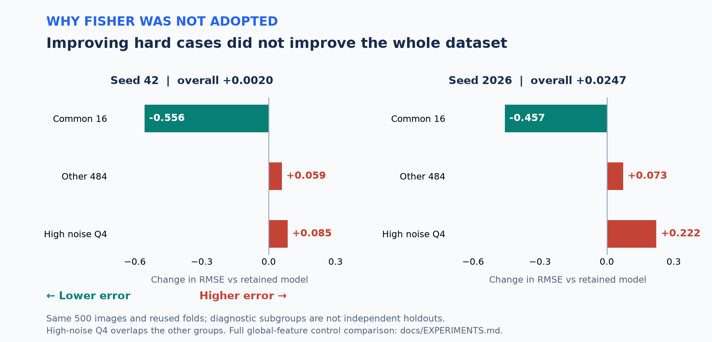

# 500장·8GB 환경에서 회귀 모델을 선택하고 제출까지 연결하기

[README](../README.md) · [대표 코드](CODE_TOUR.md) · [실험 상세](EXPERIMENTS.md)

## 결과와 담당 범위

합성 미세구조 이미지로 경도 대용값을 예측하는 개인 대회 프로젝트다. 최초 제출 대비 Public RMSE를 **12.8639 → 12.0017, 약 6.7% 감소**시켰다. 최종 구성의 OOF RMSE는 seed42/2026에서 **13.0873 / 13.1126**이었다. Public은 참가자 보고 기록이고, OOF와는 평가 표본이 다르다.

참가자가 직접 수행한 일은 로컬 실행 환경 운영, 학습·추론 실행, 결과 확인과 후속 실험 요청, 제출 및 일부 ROI 검수다. **실험 설계·코드 작성·분석·문서화에는 Codex를 활용**했다. 이 사례는 그 협업으로 만든 시스템의 선택 이유와 검증 근거를 설명한다.

## 1. 작은 데이터: 모델 선택과 평가를 분리

**문제.** 학습 영상은 500장인데, 인코더·특징·규제값·혼합 등 선택지는 많았다. 같은 평가 점수를 보며 모든 설정을 선택하면 실제보다 유리한 결과를 보고할 수 있다.

**구현.** 이미지 단위 5 outer × 3 inner 교차검증을 사용했다. 외부 fold는 평가에 두고, 내부 분할에서 alpha를 선택했다. 표준화·PCA·군집화가 필요한 경로에서는 해당 학습 분할만으로 적합했다. 핵심 `fit_fold` 함수는 외부 query의 특징만 받고 정답은 받지 않는다. D4로 만든 8개 영상도 하나의 원본 이미지에 속하게 처리했다.

**검증과 한계.** 분할 내 적합과 선택 규칙을 테스트하고, seed별 OOF·구간 지표를 남겼다. 다만 중첩 검증은 연구 전체에서 같은 500장을 반복 관찰한 선택 편향까지 제거하지 못한다. 추가 seed도 독립 데이터가 아니다. [선택 규칙과 검증 범위](VALIDATION.md)

## 2. 8GB GPU: 특징 추출과 회귀 학습을 분리

**문제.** 대형 비전 모델에 8방향 영상을 동시에 넣으면 메모리 부담이 커지고, 긴 추출 중 오류가 나면 재작업이 필요했다.

**구현.** 최종 Large·C-RADIO 인코더는 고정했다. batch 1로 D4 영상을 순차 처리하고 특징을 평균한 뒤 저장했다. 회귀 후보 비교는 그 특징을 재사용했다. 모델은 순서대로 GPU에 올리고 사용 후 해제했다.

완료된 청크는 ID·입력·설정·환경·해시를 확인한 뒤 재사용한다. 테스트 추출 전에는 학습 영상 16장의 원본·D4 특징을 다시 계산해 기존 특징과 일치하는지 확인한다. 최종 CSV는 ID 순서, 중복, 유한값, 재읽기 결과를 검사한다.

**결과와 비용.** RTX 5060 8GB에서 두 대형 인코더의 D4 특징 추출과 테스트 1,000장 예측을 완료했다. 검증된 결과부터 재개할 수 있게 했지만, 과거 캐시에 대한 강한 의존은 외부 재현을 어렵게 했다. 캐시가 줄인 총 시간은 별도로 측정하지 않았으므로 속도 향상 배수를 주장하지 않는다. [실제 구현 경로](CODE_TOUR.md#2-8gb-환경에서-중단-후-재개하는-추론)

## 3. 오류 분석: 어려운 16장과 나머지 484장을 함께 판단

**문제.** 모델을 바꿔도 반복적으로 큰 오차가 남는 16장이 있었다. 이 집단만 좋아지는 후보를 채택하면 다른 484장의 성능을 희생할 수 있었다.

**채택 사례 — D4 평균.** 대형 DINO와 C-RADIO 각각의 교체 및 동시 교체를 비교했다. 동시 교체는 두 seed 모두 전체·공통16·나머지484·잡음 상위 구간에서 개선했다. 직전 구성 대비 평균 OOF RMSE 감소는 0.1137이었다.

**미채택 사례 — Fisher Vector.** 기존 기준 A, 전역 특징의 alpha 선택 목적을 변경한 대조군 B, 전역+Fisher 후보 C를 나눴다. seed2026에서 C는 A 대비 공통16의 제곱오차 합을 **507.89 줄였지만**, 나머지484에서 **831.68 늘렸다**. 전체 손실이 증가하므로 최종 후보에 넣지 않았다. B의 공통16 성능도 C보다 좋았으므로 그 개선을 새 표현만의 효과로 해석하지 않았다.

이 분석은 사후 진단이다. 16장이 라벨 오류라는 근거는 확보하지 못했고, 별도 가중치나 정답 수정으로 처리하지 않았다. [수치와 대조군 전체](EXPERIMENTS.md)

## 기술 선택을 설명할 수 있는 근거

| 선택 | 선택 이유 | 남은 비용 / 한계 |
|---|---|---|
| 고정 인코더 + 작은 회귀기 | 추론 특징을 재사용하며 표현의 기여를 비교하기 쉬움 | 경도 정답에 맞춰 인코더를 바꾸는 효과는 제한됨 |
| 50:25:25 고정 혼합 | 대조 실험에서 교체할 구성 요소를 명확히 함 | 최적 혼합 비율이라는 주장은 아님 |
| 영상 단위 D4 평균 | 방향 변화에 따른 특징 불안정을 줄이는 가설을 검증 | 8회 추론 비용, 절대 방향 정보가 약해질 수 있음 |
| 해시·완료 manifest 검사 | 잘못된 캐시 혼합과 중복 적합을 방지 | 소스·환경 변경 시 재사용이 엄격히 제한됨 |
| 집계 근거와 CI 공개 | 데이터 없이도 수치 관계와 배포 사본을 검사 가능 | 원본 OOF·대회 점수의 독립 재현은 아님 |

## 다음 프로젝트에 반영할 점

작은 개선을 따라 같은 표본의 회귀기·규제 설정을 너무 오래 탐색했다. 목표했던 10 미만 성능은 얻지 못했다. 다음에는 탐색 예산과 중단 기준을 앞서 정하고, 가능한 경우 별도 평가 데이터를 확보하며, 과거 실험 이력에 의존하지 않는 특징·평가 인터페이스를 먼저 만들겠다.

이 프로젝트의 범위는 **소규모 데이터의 연구·검증·배치 추론**이다. 서비스 배포, 온라인 모니터링, 실제 재료의 물성 검증은 수행 범위에 포함하지 않는다. [종료 회고](RETROSPECTIVE.md)
