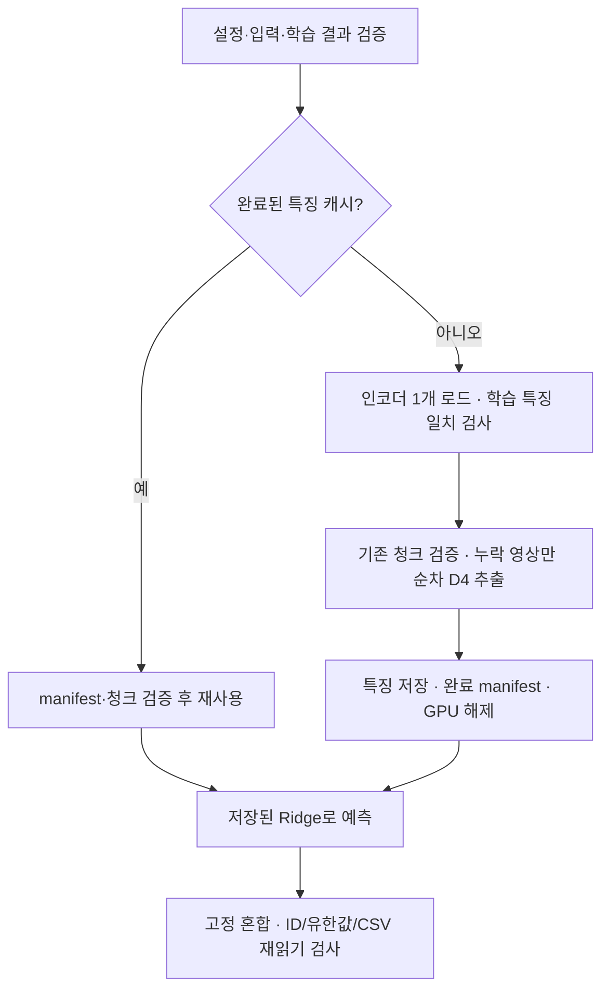

# 대표 코드 3곳으로 읽는 프로젝트

[README](../README.md) · [사례 설명](CASE_STUDY.md) · [실행 범위](REPRODUCIBILITY.md)

연구 스크립트를 처음부터 모두 읽을 필요는 없다. 아래 세 경로에서 모델 선택, 제한된 메모리의 추론, 대조 실험의 구현을 확인할 수 있다. `scripts/`와 `tests/`는 종료 시점의 원본 사본이며, 전체 실행에는 데이터·모델·과거 캐시가 필요하다.

## 1. 외부 정답을 받지 않는 모델 선택

**진입점:** [large_radio_d4_experiment.py — fit_fold](../scripts/large_radio_d4_experiment.py#L237)

- 함수 입력은 학습 특징·학습 정답·query 특징·학습 내부 Scattering 예측이다. 외부 query 정답이나 전체 OOF를 받아 alpha를 선택하지 않는다.
- 학습 부분집합 안에서 내부 분할을 만들고, alpha별 내부 예측을 모아 규칙에 따라 선택한 뒤 전체 학습 부분집합으로 다시 적합한다.
- [fit_candidates](../scripts/dinov2_factorial_engine.py#L34)에서 학습 부분집합으로 X/y 표준화를 적합한다. 모델별 선택 목적은 [검증 문서](VALIDATION.md)에 구분했다.

**검토 질문:** 전처리·모델 선택에 외부 검증 정보가 들어갈 경로가 있는가? [관련 테스트](../tests/test_large_radio_d4.py)

## 2. 8GB 환경에서 중단 후 재개하는 추론

**진입점:** [final_large_radio_d4_submission.py — extract](../scripts/final_large_radio_d4_submission.py#L284)



- [D4Extractor](../scripts/final_large_radio_d4_submission.py#L209)는 frozen/eval 상태를 검사한다.
- [anchor_record](../scripts/final_large_radio_d4_submission.py#L239)는 학습 특징과 추론 경로의 수치 일치를 확인한다.
- [test_chunk](../scripts/final_large_radio_d4_submission.py#L255)는 이미지 해시를 확인하고 이미 완료된 청크를 재사용한다.
- [write_submission](../scripts/final_large_radio_d4_submission.py#L311)은 기존 제출과 다른 목적지에 고정 혼합을 저장하고 다시 읽어 검증한다.

**검토 질문:** 중단 시 어디서 재개하는가? 입력이 바뀐 캐시를 거부하는가? 학습 때와 테스트 때의 전처리가 같은가?

## 3. 새 표현과 선택 방식의 효과를 분리

**진입점:** [cradio_fisher_engine.py — choose / compose](../scripts/cradio_fisher_engine.py#L133)

Fisher 비교는 A=현재 기준, B=전역 특징 대조군, C=전역+Fisher 후보를 함께 둔다. B와 C의 alpha 선택 목적을 맞춰, 표현 추가와 선택 규칙 변경을 구분한다. [compose](../scripts/cradio_fisher_engine.py#L160)는 S 50%와 Large 25%를 고정하고 C-RADIO 25%만 교체한다.

[fit_dictionary](../scripts/cradio_fisher_engine.py#L55)는 전달받은 학습 문맥의 descriptor로 PCA·GMM을 적합한다. [관련 테스트](../tests/test_cradio_fisher.py)는 Fisher 수식, 문맥 분리, 선택 규칙과 혼합 구성을 확인한다.

**검토 질문:** 후보가 좋아져도 그 이유를 새 특징 때문이라고 말할 수 있는가? [결과와 미채택 근거](EXPERIMENTS.md)

## 데이터 없이 직접 실행할 부분

```bash
python tools/verify_evidence.py
python -m unittest discover -s portfolio_tests -v
```

[verify_evidence.py](../tools/verify_evidence.py)는 소스 해시·집계 수치·가중치·로컬 문서 링크를 검사한다. [blend_predictions.py](../tools/blend_predictions.py)는 이미 생성된 세 예측 CSV를 ID 검사 후 고정 비율로 혼합한다. [CI](../.github/workflows/evidence.yml)는 Ubuntu·Windows에서 공개 검사를 실행한다.

이 두 도구는 연구 캐시 없이 살펴볼 수 있는 독립 진입점이다. GPU 학습 전체의 재현과는 범위를 구분한다.
