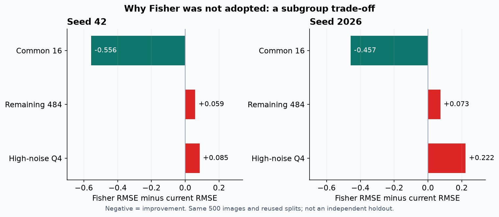

# 핵심 실험과 미채택 결과

아래는 전체 연구 중 판단에 직접 기여한 비교다. 실험마다 당시 기준 모델이 다르므로 서로 다른 행의 개선량을 같은 기준 대비로 합산하지 않는다. 모든 OOF 비교는 같은500장을 재사용했다.

## 채택한 큰 흐름

| 단계 | 관찰 | 결정 |
|---|---|---|
| Handcrafted / ResNet / DINO | 서로 다른 표현의 보완성 | 초기 앙상블 보존 |
| TabPFN-v2 | 단독 성능보다 혼합 기여가 유리 | 기존 예측과50:50 비교 후 제출 |
| Scattering486 | 제한적이지만 확인 분할에서도 개선 방향 | 고정 비율로 제출 |
| DINOv2-Large518 | 반복 실패의 오차 감소, 나머지 표본은 작은 trade-off | 확인 검증 후 별도 제출 |
| C-RADIO SO400M | 표현 보완성 | S:L:C=50:25:25 구성 |
| Large·C-RADIO D4 | 두 seed에서 전체·공통16·나머지484·noiseQ4 개선 | 최종 유지 구성 |

## 마지막 대조: Fisher Vector

| 최종 혼합 OOF RMSE ↓ | seed42 | seed2026 |
|---|---:|---:|
| A: 기존 D4 기준 | **13.087338** | **13.112608** |
| B: 전역 특징, alpha 목적 변경 | 13.138706 | 13.134558 |
| C: 전역 + Fisher | 13.089344 | 13.137278 |

| 구간 RMSE | seed42 기존 → Fisher | seed2026 기존 → Fisher |
|---|---:|---:|
| 공통16 | 36.020421 → 35.463939 | 34.923368 → 34.465899 |
| 나머지484 | 11.577950 → 11.636932 | 11.717754 → 11.790848 |
| noiseQ4 | 14.759578 → 14.844494 | 14.807060 → 15.029347 |

공통16 중 오차 감소는14장/10장이었지만, 오차 부호는16장 모두 유지됐고 worst20에 남은 수는15장/13장으로 기존과 동일했다. 제곱오차 합을 보면 공통16에서636.48 / 507.89 감소한 반면 나머지484에서662.72 / 831.68 증가했다. 따라서 전체 오차가 악화했다.

B의 공통16 RMSE는35.455910 / 34.234557로 C보다 양쪽 모두 좋았다. 공통16 개선을 Fisher의 독립적인 기여로 해석하지 않는다. Fisher는 B의 나머지484 손실을 일부 회복했지만 A를 넘지 못했다. **미채택**, 전체500 최종 Fisher 학습·제출은 하지 않았다.

## 미채택 경로도 보존

- MicroNet 전체영상+patch: 단일 경도를 patch마다 복제하지 않고 이미지 단위로 학습했지만 기존 혼합을 넘지 못했다.
- C-RADIO 공간 회귀 head: 공간 표현 학습이 전역 대조 대비 일관된 개선으로 이어지지 않았다.
- Mitra-v2 원본486: 메모리 제약을 다룬 실행 경로까지 검토했으나 기존 구성 교체 근거가 부족했다.
- C-RADIO-H, DINO-Large register: 더 큰 모델·다른 사전학습 설정이 기존 D4 구성을 안정적으로 넘지 못했다.
- 미세조정, epoch 연장, adapter, 자기지도 학습, 잔차 보정도 연구했지만 최종 유지 모델에 포함하지 않았다.

정량 집계는 [OOF 지표](../evidence/oof_metrics.json), [미채택 비교 요약](../evidence/negative_results.json)에 있다. 원래 대조의 모델명·기준·선택 규칙은 소스 스냅샷에서 확인할 수 있다.
